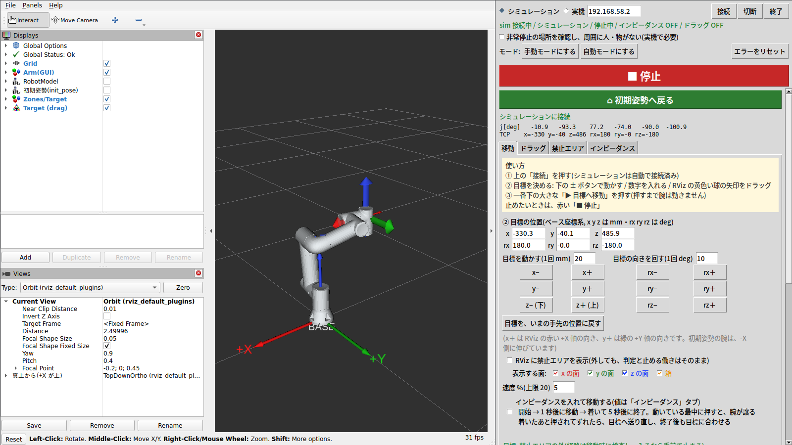
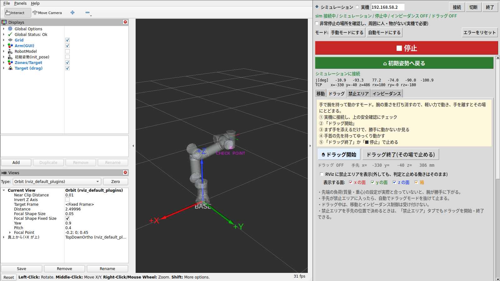
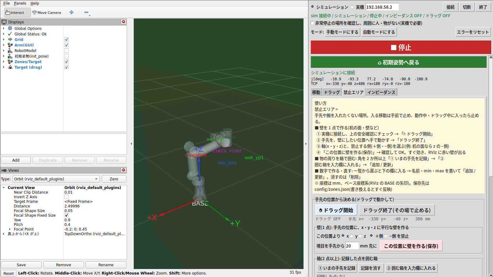
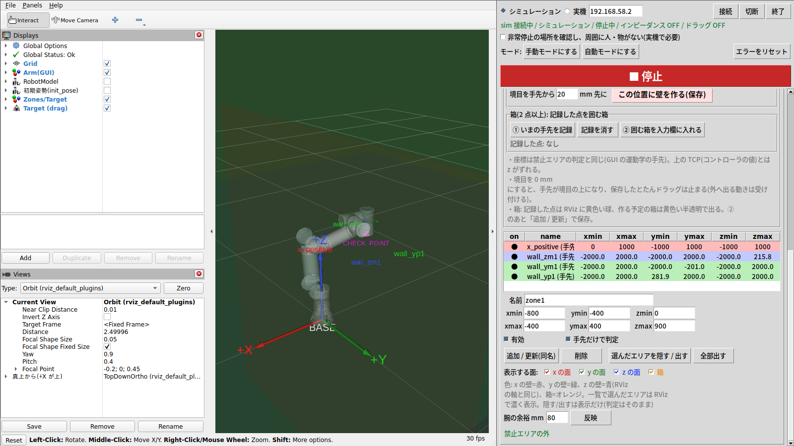
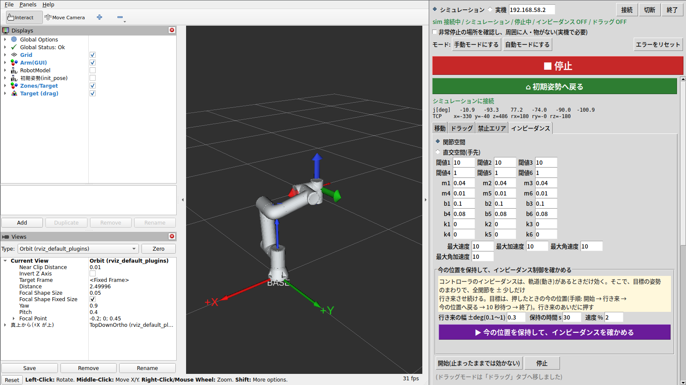

# 操作 GUI の使い方

FR3 実機(とシミュレーション)を動かす GUI(`gui/fr3_tk.py`)の使い方と、画面の各項目の意味。
安全の約束は [CLAUDE.md](../CLAUDE.md)。インピーダンス制御で分かったことは [impedance_notes.md](impedance_notes.md)。

## 起動
```
cd ~/fr3_tutorial
./docker/run.sh gui              # ドライラン(実機には何も送らない。動作の内容だけを表示)
./docker/run.sh gui --execute    # 実機に送れる状態(送るたびに確認の画面が出る)
./docker/run.sh stop             # 止める
```
ブラウザで `http://localhost:6080/vnc.html?autoconnect=true&resize=scale` を開く。左が RViz(腕と禁止エリアの表示)、右が操作の画面。



**実機に送れるのは、次の 3 つがそろったときだけ**
1. `--execute` を付けて起動した
2. 画面の「非常停止の場所を確認し、周囲に人・物がない」にチェックを入れた
3. 送るたびに出る確認の画面で OK を押した

送ったもの・断ったものは、すべて `logs/gui_*.jsonl` に残る。

## 上の欄(どのタブでも見える)
| 項目 | 意味 |
|---|---|
| シミュレーション / 実機 | 接続する相手。シミュレーションは起動時に自動で接続する |
| IP の欄 | 実機の IP(出荷時 192.168.58.2) |
| 接続 / 切断 | 実機との接続。接続し直すと、安全確認のチェックは外れる |
| 終了 | 安全に終わる(ドラッグ・インピーダンスを切る → 動作を止める → 接続を閉じる)。腕は今の姿勢で止まる |
| 状態の欄 | 接続先、ドライランか、動作中か、インピーダンス・ドラッグの ON/OFF。実機では、アームの有効/無効、**手動/自動モード**、ツール座標の番号も出る |
| 安全確認のチェック | 非常停止の場所と、周囲に人・物がないことを確かめたら入れる。入れないと実機に送らない |
| モード: 手動モードにする / 自動モードにする | コントローラのモードを切り替える(腕は動かない)。インピーダンス中・ドラッグ中・動作中は切り替えない |
| エラーをリセット | コントローラの故障をリセットし(腕は動かない)、インピーダンスが残っていれば切る。故障のあとは命令がすべてエラー 14 で断られるので、これか Web 画面でクリアする |
| **■ 停止** | いつでも押せる。手順の途中でもやめ、ドラッグ・インピーダンスを切ってから、動作を止める |
| 紫の帯(カウントダウン) | インピーダンスを入れたままの手順の実行中だけ、■ 停止 の下に出る。いまの段と、インピーダンスが切れるまで(移動前の待ち・保持・着いたあとの待ち)の残り秒数。移動中は「着いてから 5 秒で終了」と出す |
| ⌂ 初期姿勢へ戻る | 初期姿勢(`init_pose.csv` の関節角)へ移動する。検査はほかの移動と同じ。**腕が止まり、インピーダンス・ドラッグ・手順が終わり、エラー・非常停止がないときだけ押せる**(それ以外は灰色) |
| メッセージの欄 | 直前の操作の結果(緑 = 成功、赤 = 失敗・断った理由、`[ドライラン]` = 送っていない) |

## 「移動」タブ
(画面は、上の「起動」の図)

| 項目 | 意味 |
|---|---|
| 目標の位置 x y z rx ry rz | 手先の目標(ベース座標系。x y z は mm、rx ry rz は deg)。RViz の黄色い球の矢印をドラッグしても変わる。RViz の目標の球は、腕が押されて動いても動かない(目標の数値の位置に描く) |
| 目標を動かす(1 回 mm)/ 目標の向きを回す(1 回 deg) | ± ボタン 1 回で、目標をその量だけずらす・回す |
| 目標を、いまの手先の位置に戻す | 目標の欄に、今の手先を入れる |
| RViz に禁止エリアを表示 / 表示する面 | 表示だけの切り替え。外しても、判定と止める働きはそのまま |
| 速度 % | 移動の速さ(上限は `config/limits.json` の `max_vel_percent`、既定 5%) |
| インピーダンスを入れて移動する | チェックすると、**インピーダンス開始 → 1 秒後に移動 → 着いて 5 秒後に終了** の順で動く。値は「インピーダンス」タブのもの。動いている最中に押すと、腕が譲る。インピーダンス中は手先の直線移動が動かないので、**関節移動に直して送る**(経路は直線でない。確認の画面に出る)。着いたあと押されて `imp_return_tol_deg`(0.3°)以上ずれたら、インピーダンスを入れたまま目標へ送り直す。インピーダンスを切ったあとも、ずれていれば目標へ合わせる |
| ▶ 目標へ移動 | 押すまで腕は動かない。実機では、動く関節と量を出す確認の画面が出る |
| 関節角度で指定 / いまの関節角を入れる / 初期姿勢を入れる / 関節角度へ移動 | 関節角(deg)で目標を決めて移動する |

**移動の前の検査**(すべての移動で同じ)
- 速度の上限、関節の範囲(メーカーの範囲より `joint_margin_deg` だけ内側)、手先の作業範囲(`tcp_mm`)
- 禁止エリア: 途中で手先が禁止エリアに入るなら、**その手前(`zone_stop_margin_mm`、既定 20 mm)で止まる目標に縮める**。確認の画面に、縮めたことが出る
- インピーダンス中・ドラッグ中は、ふつうの移動はしない

## 「ドラッグ」タブ
手で腕を持って動かすモード(腕の重さを打ち消すので、軽い力で動き、手を離すとその場にとどまる)。


| 項目 | 意味 |
|---|---|
| ✋ ドラッグ開始 / ドラッグ終了(その場で止める) | ドラッグモードに入る・抜ける |
| 状態の文字 | ドラッグの ON/OFF と、今の手先の位置(禁止エリアの判定と同じ点) |

- 手先が禁止エリアに入ったら、自動でドラッグモードを抜けて止まる。
- 先端の負荷(質量・重心)の設定が実際と合っていないと、腕が勝手に下がる。

## 「禁止エリア」タブ
禁止エリアは `config/zones.json` に保存される。GUI は、このファイルが書き換えられたら自動で読み直す(手で編集してもよい)。

**判定する点**: 手首の先(フランジ)から、手首の z 方向に `tool_length_mm`(既定 100 mm)先の点。RViz では、ドラッグ・禁止エリアのタブのとき、腕を半透明にし、**マゼンタの球**(CHECK POINT)で表示する。




| 項目 | 意味 |
|---|---|
| 手先の位置から決める | ドラッグで手先を動かし、その位置からエリアを作る |
| 壁(1 点) | 今の手先の位置に、x・y・z のどれかに平行な壁を作る。「この位置より ＋側 / −側 を禁止」と、境目を手先から何 mm 先にするかを選び、「この位置に壁を作る(保存)」 |
| 箱(2 点以上) | 「① いまの手先を記録」を何回か押し、「② 囲む箱を入力欄に入れる」で、記録した点を囲む箱を作る。「記録を消す」でやり直す |
| エリアの一覧 | 色は壁の向き(x の壁 = 赤、y = 緑、z = 青、箱 = オレンジ)。選ぶと RViz で濃く表示する |
| 名前 / xmin ymin zmin / xmax ymax zmax | エリアの名前と、箱の範囲(mm)。3 段で入力する |
| 有効 | 外すと、判定に使わない(表示はごく薄く残る) |
| 手先だけで判定 | 入れると、判定する点(手先)だけで判定する。外すと、腕の各部と「腕の余裕 mm」も使う |
| 追加 / 更新(同名)・削除 | 一覧の編集。保存すると、すぐ判定に使われる |
| 選んだエリアを隠す / 出す・全部出す | RViz の表示だけ |
| 腕の余裕 mm・反映 | 「手先だけで判定」を外したエリアで、腕の各部にとる余裕。「反映」で使い始める |
| 一番下の文字 | 今、腕が禁止エリアの外か中か |

## 「インピーダンス」タブ
コントローラ内蔵のインピーダンス制御(マニュアル 9.33)。**止まっているだけでは効かず、軌道(動き)があるときだけ効く**(実機で確認。[impedance_notes.md](impedance_notes.md))。



| 項目 | 意味 | 範囲(マニュアル) |
|---|---|---|
| 関節空間 / 直交空間(手先) | 関節ごとのトルクで判定するか、手先の力で判定するか | — |
| 閾値 1〜6 | この力を超えると腕が譲る。関節空間は N·m、直交空間は N(前後左右上下)と N·m(回転) | 関節: j1〜j3 10〜50、j4〜j6 1〜10 / 直交: 30〜150 N、7〜30 N·m |
| m 1〜6(質量) | 見かけの重さ。小さいほど、すばやく動き出す(軽く感じる) | j1〜j3 0.01〜1(推奨 0.04)、j4〜j6 0.001〜1(推奨 0.01) |
| b 1〜6(減衰) | 動くときの抵抗。小さいほど、すばやく逃げる。小さすぎると振動する | j1〜j3 0.1〜2(推奨 0.1)、j4〜j6 0.008〜1.5(推奨 0.08) |
| k 1〜6(剛性) | 元の道筋へ引き戻すばね。0 だと戻らない。**GUI は `k_max` により 0 だけ** | 範囲の記載なし(推奨 0) |
| 最大速度・最大加速度・最大角速度・最大角加速度 | 押されて逃げるときの速さの上限。**0 にしない**(Web で 0 にしたら、軸 4 の速度リミット超過のエラーが出た) | 推奨 50°/s、50°/s²。GUI の上限は `config/limits.json` |

**今の位置を保持して、インピーダンス制御を確かめる**(紫のボタン)
止まった状態の代わりに、今の位置のまわりで全関節を ± 少しだけ行き来させ続け、そのあいだに押して確かめる。
1. インピーダンス開始 → 1 秒待つ
2. 今の位置のまわりで、全関節を ±「行き来の幅」で行き来(「保持の時間」秒、「速度 %」で)
3. 今の位置へ戻る → インピーダンスを入れたまま 10 秒待つ → 終了

| 項目 | 意味 |
|---|---|
| 行き来の幅 ±deg | 既定 0.3°(`hold_amp_min_deg` 0.1°〜`hold_amp_max_deg` 1°)。手先は数 mm しか動かない。小さすぎると、押したときにコントローラが故障になる(0.001° で故障 1-23) |
| 保持の時間 s | 既定 30 秒(上限 300) |
| 速度 % | 既定 2% |

- 行き来の両端も、ふつうの移動と同じ検査を通す。禁止エリアにかかるならやめる。
- 進み具合は、ボタンの下(と「移動」タブ)に紫の文字で出る。
- 今の位置への長さ 0 の移動は送らない(インピーダンス中に送ると、速度リミット超過のエラーになるため)。

**開始(止まったままでは効かない)/ 停止**: インピーダンスを入れる・切るだけ。止まったままでは押しても譲らない。

## 設定ファイル(`config/`)
| キー | 意味 |
|---|---|
| `limits.json` `joint_deg` / `joint_margin_deg` | 関節の範囲と、その内側にとる余裕 |
| `max_vel_percent` / `default_vel_percent` | 移動の速度の上限と既定値 |
| `tcp_mm` | 手先の作業範囲(x, y, z, 半径) |
| `impedance` | インピーダンスの値の上限(閾値の範囲、`m_max`、`b_max`、`k_max`、最大速度など)と、ゆっくりの既定値 |
| `hold_amp_max_deg` | 「今の位置を保持」の行き来の幅の上限 |
| `imp_return_tol_deg` | インピーダンスを入れた移動・保持で、着いたあと、この角度以上ずれたら目標へ送り直す |
| `zone_stop_margin_mm` | 禁止エリアの手前で止める距離 |
| `torque_display_scale` | 関節トルクの表示の倍率(SDK の値が N·m の約 1/100 に見えるため ×100。推定) |
| `zones.json` | 禁止エリアの一覧(`min` / `max` [mm]、`enabled`、`target: "tcp"` は手先だけで判定、`wall` は表示の向き) |
